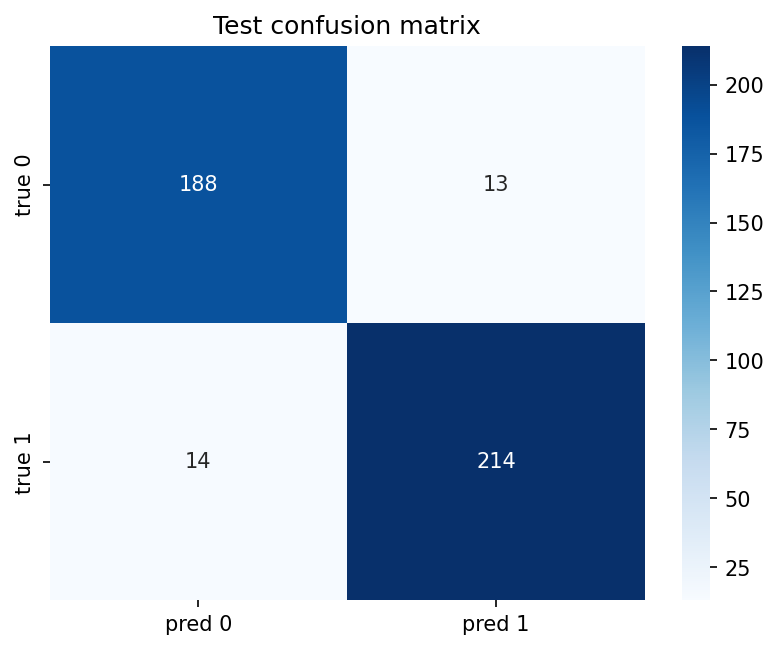
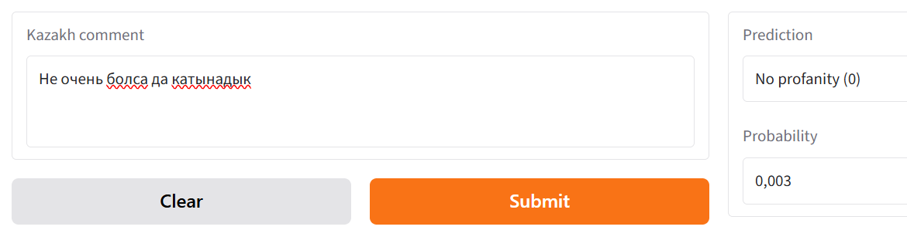
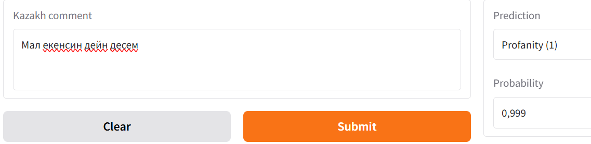

# Kazakh Profanity Detection in Product Reviews

**Author:** `Ismagulova Zhanerke`, student ID `25MD0192`  
**Course:** KBTU DSSC5113, Bonus project, Fall 2026

## 1. Task
Input: one Kazakh comment or review. Output: a binary label and a probability.
- `0` = no Kazakh profanity
- `1` = profanity present

A negative review is **not** automatically profane ("Жаман ойын, қате береді" is `0`).

## 2. Data
- **Source:** Kazsandra, (https://huggingface.co/datasets/issai/kazsandra)
- **Relation to product reviews:** The comments are user reviews written in Kazakh (often mixed with Russian) about digital products and some household goods. Reviewers often express anger with insults, so a store or marketplace that publishes reviews needs a moderation tool that can detect profanity in this kind of text. The comments are informal: they contain slang, misspellings, Latin letters, emoji and masked words. A negative review is not automatically profane, so the labels separate rude language from ordinary criticism.
- **Labels:** binary `label` column, revised by me. The file used for training is `kazakh_profanity_share.xlsx` (revised version.
- **Size:** 3061 comments in the file; after cleaning and removing empty or duplicate comments: **3039**.
- **Class distribution (3039):** 1494 clean (`0`), 1545 profanity (`1`).
- **Personal data:** the repository contains only ids, labels and split names (`artifacts/splits.csv`), no review text.

### Labeling rules
1. `1` if the comment contains a Kazakh profane or insulting word. Russian profanity inside Kazakh text also counts, because mixed-language comments are common.
2. Masked words (`с***`) count as `1` if the word is recognisable.
3. Spelling variations count the same: `қотақ`, `котак`, `qotaq` (Latin letters), repeated letters (`өтттте`).
4. **My own rule for `қатын`:** the word `қатын` (woman/wife used as an insult) is always labeled `1`, because I do not want women to be called that. This is a **lexical rule**: it applies even when the word may be a typo of `қатты` ("very"), e.g. *Маған қатын ұнады* is `1`. The only exception is the verb `қатынау` ("to commute"), e.g. *үйге қатынайын дедім* is `0`.
5. Ambiguous words (for example `мал`, which means "livestock" or is an insult) are labeled by the context of the comment. In practice the insult use is much more common in this data, which causes some errors (see section 7).
6. Negative sentiment alone is never a reason for `1`.

### Labeled examples
| Comment | Label | Why |
|---|---|---|
| Өте жақсы қолданба, ұнады | 0 | positive, clean |
| Жаман ойын, қате береді, ақшаны қайтарыңдар | 0 | negative review, no profanity |
| hi уйге қатынайын дедим | 0 | verb `қатынау` (commute), not the insult |
| Маған қатын ұнады | 1 | contains `қатын`, my lexical rule |
| Орыс қатын жауап бермейді | 1 | insult |
| Ote jaqsy oiyn, rahmet | 0 | Latin script, clean |


### Synthetic examples
**120 synthetic comments** were added to the **training set only** (never to validation or test). They are listed in `synthetic_train_examples.csv`.
- 60 sentences with the verb `қатынау` (label 0)
- 60 clean comments with an insulting ending such as "орыс қатын" (label 1)

## 3. Splits
- Cleaned text is deduplicated. Near-duplicates (cosine similarity of character n-grams >= 0.9) are put in the same group and never split across train, validation and test.
- `StratifiedGroupKFold`, 7 folds, **random seed 42**.

| Split | Comments | Class 0 | Class 1 |
|---|---|---|---|
| Train | 2178 (+120 synthetic = 2298 used for training) | 1076 | 1102 |
| Validation | 432 | 217 | 215 |
| Test | 429 | 201 | 228 |

TF-IDF features, the model weights and the decision threshold are fit or chosen on training/validation data only.

## 4. Model
**Final model:** `xlm-roberta-base` fine-tuned for 2-class classification.
- **Why:** XLM-R was pre-trained on text in 100 languages including Kazakh, so it already knows Kazakh words. With about 2.3k training examples, fine-tuning is far better than training a network from scratch.
- **Text to input:** `clean_for_bert` (lower-case, remove links, @names and emoji, shorten repeated letters, remove punctuation but keep masks `* # @ $`) -> SentencePiece word pieces -> numbers -> cut or padded to 128 tokens -> softmax probability of class 1.
- **Unknown words:** split into smaller known pieces, so there is no unknown-word token.
- **Long comments:** cut after 128 tokens (a limitation, see section 8).
- **Training:** cross-entropy loss, AdamW (learning rate 3e-5, weight decay 0.01), linear warm-up (10%) and decay, batch size 16, gradient clipping 1.0, seed 42. Up to 10 epochs with early stopping (patience 2 epochs on validation F1). Training stopped after epoch 8; the **best epoch was 6** (validation F1 0.938 at threshold 0.5), and that checkpoint is saved.
- **Decision threshold:** chosen on the validation set from 0.10-0.90: **0.77** (validation F1 0.940). The threshold is high because the fine-tuned model is over-confident (many probabilities are close to 0 or 1).
- **Baseline (for comparison only, not the final model):** TF-IDF (character n-grams 1-4 and word n-grams 1-2) + logistic regression, `C = 100`, text cleaned with `clean_for_tfidf` (Latin letters converted to Cyrillic, Kazakh-only letters folded to Russian letters, e.g. `қ -> к`). Validation F1 0.925 at threshold 0.5, 0.933 at its best threshold (0.38).
- The final model was picked on validation F1: XLM-R 0.940 vs TF-IDF 0.933.

## 5. Setup and usage
```bash
pip install -r requirements.txt
```
**Train:** open `Kazakh_Profanity_Simple.ipynb` in Google Colab (GPU runtime), upload `kazakh_profanity_share.xlsx`, *Run all*.

**Predict without retraining:** download the model archive [(`kz_profanity_model.zip`)](https://drive.google.com/file/d/1h3R0_oaip8ZH2lUdILULkwOANeW_9E6-/view?usp=sharing), unzip it into `artifacts/`, then in the notebook run the `predict(...)` cell, or:
```python
predict("Орыс қатын жауап бермейді")
# [{'label': 1, 'probability': 0.999, 'text': '...'}]
```
Files needed in `artifacts/`: `bert_model/` (model and tokenizer), `config.json`, `kz_text.py` (and `tfidf_model.joblib`, used only for the baseline).

## 6. Results (test set, evaluated once)
Positive class = profanity. **n = 429** test comments.

| Metric | Value |
|---|---|
| Precision | 0.943 |
| Recall | 0.939 |
| F1 | 0.941 |
| Accuracy | 0.937 |

Confusion matrix (rows = true, columns = predicted):



| Model | Test F1 (class 1) |
|---|---|
| **XLM-R fine-tuned (final, threshold 0.77)** | **0.941** |
| TF-IDF + logistic regression (threshold 0.5) | 0.935 |

The difference between the two is about 0.6 percentage points, which is only 1-3 comments out of 429, so **it is not a significant difference**. The test set is small, so I treat both models as similar in quality.

**False positive** = a clean comment is flagged as profane, so an honest customer's review is blocked (13 cases). **False negative** = a profane comment is not flagged, so abuse is published (14 cases). For moderation, missed insults hurt users, while blocked honest reviews are censorship, so a practical design sends uncertain comments to a human moderator.

## 7. Error analysis
Examples from the test set (probability of profanity in brackets).

1. **Ambiguous word `мал`, false positives:** "Маңғыстауда мал жоқ па?" (0.999) is a clean sentence about livestock, and "Ай малдес топқой тик ток" (0.999) is also labeled clean. In the training data `мал` is mostly an insult, so the model learned a word-level shortcut. Fix: more training examples of literal `мал`, or a context check.
2. **Latin script and misspellings, false positives:** "Jaman oiyn eken" (0.985, "bad game") and "Ката беред" (0.994, a misspelling of "қате береді", "gives an error") are clean. Fix: more Latin-script and misspelled clean examples, or transliterate Latin text before the model.
3. **Russian profanity and slang, false negatives:** "өте күшті емес сука" (0.011) and "…дорогие рукожопы)))" (0.003) were missed. Russian words in short Kazakh comments are rare in training. Fix: add Russian profanity examples or a Russian profanity word list as an extra feature.
4. **Disguised or stretched spelling, false negatives:** "Сіккккееннім барғооое" (0.024) and "Koti boq til istemet" (0.015) were missed because of repeated letters and Latin script. Fix: stronger normalisation and character-level features.
5. **Ambiguous or noisy labels:** "Есектер" ("donkeys", 0.010) and "Күшті Далпдвбр" (0.999) are hard even for a human, so some errors come from the labels rather than the model.
6. **Over-confidence:** many wrong predictions have probability 0.99+ or 0.00x, so the probability can't be used to find uncertain cases. Fix: temperature scaling or an ensemble with another model.

## 8. Limitations
- Small dataset (3039 comments) and small test set (429).
- Labels depend on my own rules (especially `қатын`), and some comments are ambiguous.
- The `қатын` rule is lexical (the word is always `1`), so the model is not expected to understand context for this word.
- Synthetic examples cover only the `қатын` / `қатынау` case, not other ambiguous words such as `мал`.
- Long comments are cut after 128 tokens.
- Mostly Cyrillic text; Latin-script Kazakh is only about 3% of the data.
- Domain is user reviews; the model may fail on other kinds of text.

## 9. AI assistance statement
I used Gemini to help to suggest the text cleaning, the near-duplicate split and debug the code.


## 10. Repository files
- `Kazakh_Profanity_Simple.ipynb` 
- `kz_text.py`, `requirements.txt`
- `synthetic_train_examples.csv`
- `artifacts/splits.csv`
- `artifacts/test_metrics.json`
- `artifacts/confusion_matrix.png`
- `artifacts/synthetic_train_examples.csv`

The large model files are stored outside GitHub in zip file.


---

## Demo
[`Check demo`](https://huggingface.co/spaces/fourcolored/Kazakh_Profanity_Detection)



